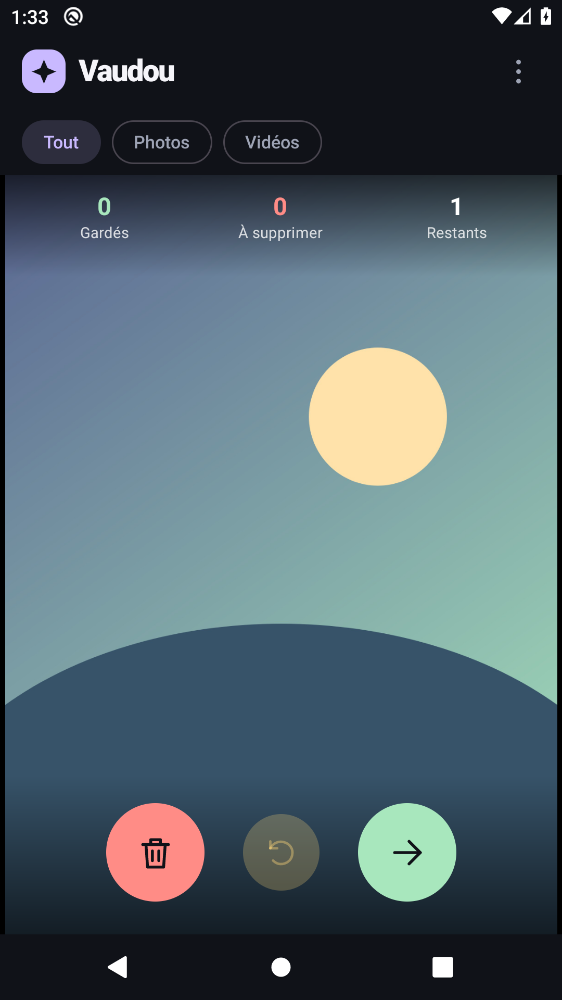

# Vaudou Sorter

Application Android de tri de galerie, entièrement écrite en Kotlin avec Jetpack Compose. Compatible **Android 10 et versions suivantes (`minSdk = 29`)**. Les niveaux de compilation et de cible du projet existant restent à 37.

## Utilisation

- À la première ouverture, autoriser les photos et les vidéos. Les médias disponibles sont présentés dans un ordre aléatoire, sans répétition des éléments déjà triés.
- Glisser à gauche, ou toucher la poubelle corail, pour écarter un média. Glisser à droite, ou toucher la flèche verte, pour le garder.
- Les trois boutons sont superposés en bas du média : **Supprimer** en corail, **Annuler** sur fond jaune et **Garder** en vert. Annuler ramène le dernier choix. Plusieurs annulations successives sont possibles.
- Le bandeau conserve uniquement le logo, le nom **Vaudou** et le menu **⋮**. En dessous, les filtres **Tout / Photos / Vidéos** affinent la sélection. Le média occupe tout l’espace restant, sans slogan ni métadonnées.
- Les compteurs **Gardés / À supprimer / Restants** restent discrets en haut du média. « À supprimer » compte les médias marqués, encore présents sur le téléphone pendant le tri.
- Les vidéos se lisent automatiquement dans l’écran de tri, en boucle jusqu’au choix. Toucher la vidéo pour la mettre en pause ou la reprendre. La lecture s’arrête en changeant de média et se met en pause en ouvrant un menu ou en passant l’application en arrière-plan.
- Le menu **⋮ → Choisir un dossier** permet de limiter le tri à un album. Par défaut, toute la galerie est sélectionnée.
- Ouvrir **⋮ → À supprimer** : l’onglet **À supprimer** liste les photos et vidéos marquées et permet de les restaurer ; l’onglet **Supprimés** conserve leur nom, leur type et la date de leur effacement réel.
- Les choix sont appliqués à la sortie : bouton **Retour**, **⋮ → Appliquer et quitter**, **Accueil** ou changement d’application. Sur Android 10, la suppression est confiée à un travail persistant en arrière-plan. Les écrans de permissions, les paramètres, la rotation et le verrouillage de l’écran ne déclenchent pas une suppression.

Les choix sont enregistrés localement et repris au prochain lancement. Un média déjà trié ne revient pas, même après un changement de filtre, de dossier ou un redémarrage. Seules une annulation ou une restauration explicite le réintroduisent. Un média gardé reste dans son dossier d’origine. Aucun fichier marqué n’est effacé pendant le tri. Après application des choix à la sortie, les fichiers réellement supprimés ne peuvent plus être restaurés.

Les photos principales sont décodées depuis le **fichier original** avec `ImageDecoder`, à la taille utile de la zone d’affichage, sans agrandir artificiellement les petites sources. L’orientation EXIF est respectée. Les vignettes système ne servent plus qu’aux petites listes et aux aperçus vidéo ; elles ne sont pas agrandies pour afficher les photos.

## Permissions et suppression

Sur Android 10 à 12, l’application demande `READ_EXTERNAL_STORAGE`. Sur Android 10 uniquement, elle demande aussi `WRITE_EXTERNAL_STORAGE` pour la suppression. À partir d’Android 13, elle demande `READ_MEDIA_IMAGES` et `READ_MEDIA_VIDEO`. L’accès à une sélection limitée de médias est pris en charge à partir d’Android 14.

À partir d’Android 11, le stockage cloisonné est utilisé. Sur Android 10, le mode de stockage historique est activé, comme le recommande la documentation Android pour modifier ou supprimer les médias sur cette version. Aucune permission `MANAGE_EXTERNAL_STORAGE` et aucun accès réseau. Les dossiers sont les albums locaux indexés par `MediaStore`, y compris les volumes externes accessibles ; les contenus uniquement présents dans le cloud ne sont pas listés.

Sur **Android 10**, la liste marquée est enregistrée atomiquement avant la fermeture puis traitée par `WorkManager`, indépendamment de l’activité. Le mode historique évite un défaut de certaines versions Android 10 qui retirent l’entrée de galerie sans effacer le fichier. L’historique n’est mis à jour qu’après suppression ; un échec conserve le média dans la liste à supprimer. Les sauvegardes retardées sont versionnées afin qu’elles ne puissent pas réintroduire un média déjà effacé.

À partir d’**Android 11**, `MediaStore.createDeleteRequest` impose une confirmation système. **Retour** ou **Appliquer et quitter** la demandent avant de fermer ; un refus conserve les fichiers. Si l’utilisateur part avec **Accueil**, la liste est conservée et la confirmation est proposée au prochain retour dans l’application, car une application en arrière-plan ne peut pas imposer ce dialogue. Les choix ne sont pas transférés dans les sauvegardes Android, car leurs URI sont propres à l’appareil.

Un arrêt forcé par les paramètres Android peut suspendre les travaux jusqu’au prochain lancement. Un crash ou un arrêt brutal avant la mise en file conserve les choix enregistrés, qui seront appliqués à une prochaine sortie normale ; aucune opération fiable ne peut reposer uniquement sur `onDestroy`.

Références : [décodage des images originales](https://developer.android.com/reference/android/graphics/ImageDecoder), [accès et suppression des médias](https://developer.android.com/training/data-storage/shared/media), [cycle de vie des activités](https://developer.android.com/guide/components/activities/activity-lifecycle), [accès limité aux photos et vidéos](https://developer.android.com/about/versions/14/changes/partial-photo-video-access).

## Ouvrir et compiler

Ouvrir ce dossier dans Android Studio, synchroniser Gradle, puis lancer **app** sur un téléphone ou un émulateur Android 10 / API 29 ou supérieur. Le projet utilise le SDK 37 et un JDK 25, comme le projet initial. Le SDK 29 de compilation n’est pas nécessaire pour exécuter l’application sur Android 10.

Depuis PowerShell, avec un JDK configuré :

```powershell
.\gradlew.bat :app:assembleDebug :app:testDebugUnitTest :app:lintDebug
.\gradlew.bat :app:connectedDebugAndroidTest
```

APK de développement : `app/build/outputs/apk/debug/app-debug.apk`.

## Organisation

- `data/ReviewSession.kt` : tirage aléatoire, historique, annulation, filtres et corbeille ; règles indépendantes d’Android.
- `data/GalleryRepository.kt` : requêtes `MediaStore` et permissions.
- `data/PhotoLoader.kt` : décodage du fichier original à la résolution utile.
- `data/ReviewStore.kt` : choix, file de suppression persistante, historique et sauvegardes versionnées.
- `data/ExitDeletions.kt` : travail de suppression à la sortie et reprise après fermeture.
- `GalleryViewModel.kt` : état de l’écran, opérations en arrière-plan et confirmations de suppression.
- `ui/` : interface Compose, cartes animées, lecteur vidéo Media3 intégré, dossiers et listes de suppression. Les photos originales et les aperçus sont chargés hors du thread principal ; leur cache mémoire est limité à 24 Mio. Seule la vidéo courante possède un lecteur actif ; ses fichiers ouverts sont libérés quand l’application devient invisible.

Les tests unitaires couvrent le parcours sans répétition, les filtres, la reprise, les annulations et les suppressions partielles. Les tests sur appareil couvrent les gestes, les boutons, l’annulation après un bouton, les requêtes de galerie et le cycle corbeille / annulation / suppression d’une image créée par le test sur Android 10.

Version **1.2** : validation sur émulateurs **API 29 et API 35**. Les tests couvrent la netteté du décodage 1 200 × 1 800, l’orientation EXIF, la conservation des petits originaux, la suppression physique après Retour ou une vraie pression sur Accueil, les photos et vidéos marquées juste avant la fin de l’animation, la migration des anciens choix, la protection contre les sauvegardes périmées et le refus puis l’acceptation du dialogue système Android récent. Les tests de tri et de lecture vidéo restent présents. Compilation de l’APK réussie ; aucune erreur Android Lint.

Capture réelle de l’application sur Android 10 avec un média de démonstration :



[Liste avant la sortie](docs/screenshots/pending-deletions.png) · [Historique après effacement](docs/screenshots/deletion-history.png)
